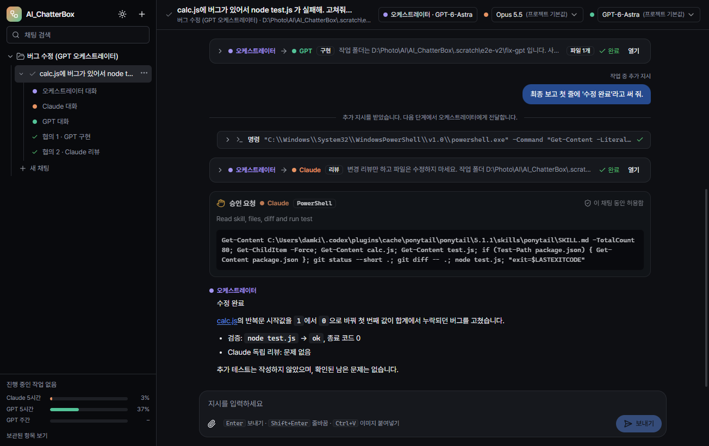

# AI_ChatterBox

채팅 하나에 지시하면 **마스터**가 계획을 세우고, 일의 양에 맞춰 **클로드 N호**(Claude Code), **지피티 N호**(Codex), **Antigravity N호**(Antigravity 또는 Gemini 웹), **Grok N호**(Grok CLI) 작업자를 꾸려 구현과 리뷰를 나눠 맡기는 Windows 데스크톱 앱입니다 (Electron + React + TypeScript).



## 주요 기능

### 작업 방식과 협업 흐름
- 프로젝트 하나가 작업 폴더 하나입니다. 프로젝트 아래에 채팅을 만들며, 채팅을 펼치면 `마스터 대화 · 클로드 1호 · 클로드 2호 · 지피티 1호 … · 협의 N (보낸 쪽 → 받는 쪽)` 트리가 나타납니다.
- 마스터가 필요한 만큼 작업자를 만들고(`spawn`) 닉네임으로 일을 맡깁니다(`ask`). 고칠 범위(scope)가 겹치지 않는 구현과 리뷰는 동시에 진행되며, 작업자끼리도 닉네임으로 서로 묻습니다. 범위 밖 쓰기는 자동 거부되고, 서로 기다리는 순환 호출은 거절됩니다. 기본 동시 한도는 클로드 3명 + 지피티 3명 + Antigravity 1명 + Grok 3명이며 프로젝트 설정에서 조절합니다.
- 슬래시 명령으로 `/plan`(계획 → 실행/수정/취소), `/goal`(목표를 끝날 때까지 진행), `/review`, `/status`, `/model`, `/new`, `/stop`, `/compact`를 지원합니다.
- 한 작업도 UI·API·테스트 등 겹치지 않는 파트로 나눠 `ask_parallel`로 배정합니다. 작업자는 `send_message`로 진행 중인 동료와 직접 협의하며 다음 앱 도구 호출이나 배정 때 메시지를 받습니다. `read_messages`로 새 메시지를 확인하고 대기 동료에게 `ask`/`ask_parallel`로 의견·리뷰를 요청합니다. 메시지는 양쪽 작업자 대화에 저장됩니다. 실제 분담과 도구 선택은 선택한 모델의 지시 이행에 따릅니다.
- 기본 협업 흐름은 계획 → 작업자 구성 → 범위를 나눠 구현 → 다른 작업자가 리뷰 → 수정 → 최종 보고 순으로 이어집니다. 협의 내용은 채팅 안에 카드로 실시간 표시됩니다 (예: "마스터 → 클로드 2호 · 구현 · src/ui/**").

### Gemini 웹 사용량 조회 (0.4.14)
- 일부 계정에 적용된 새 사용량 화면과 기존 화면을 모두 읽습니다. 카드의 실제 표시 텍스트에서 현재·주간 수치와 초기화 시각을 수집하며, 숨겨진 요소나 진행 막대 너비로 비율을 추정하지 않습니다.
- 사용량 카드의 제목이 먼저 표시돼도 현재·주간 퍼센트가 준비될 때까지 기다립니다. 숫자가 끝내 나타나지 않으면 사용량을 추정하지 않습니다.
- 계정 브라우저에서 사용량 페이지를 보고 있을 때도 **사용량 확인**을 실행할 수 있습니다. 조회용 숨김 창은 계정별 로그인 세션을 사용하며 작업 중인 대화와 초안을 유지합니다.

### 이름과 로그인 상태 (0.4.12)
- 화면의 계열 이름은 **클로드 / 지피티 / 제미나이 / 그록**입니다. 기존 기본 작업자 이름도 자동으로 통일하며 세션·대화 기록·사용자 지정 이름을 유지합니다. 실제 CLI 명칭과 모델 ID는 바꾸지 않습니다.
- CLI 설치와 로그인을 별도로 확인합니다. 로그인이 없거나 확인되지 않으면 헤더를 흐리게 표시하고 **로그인 필요 / 로그인 확인 필요** 배지를 붙입니다. 배지 또는 앱으로 다시 돌아올 때 상태를 확인합니다(최대 30초 캐시). 로그인 확인은 모델 프롬프트를 전송하지 않습니다.
- 제미나이 웹 모델의 연결은 웹 계정 관리에서 별도로 확인합니다. CLI 인증 상태가 웹 모델을 비활성화하지 않습니다.
- 그록은 사용자 제공 캐릭터 참고 이미지의 금발·검은 의상·X 머리핀을 반영한 12종 표정을 사용합니다. [그록 이미지와 생성 프롬프트](docs/grok-character-art.md).

### Gemini 웹 계정 선택 (0.4.11)
- 마스터가 전체 계정의 잔여량·조회 시각·작업 상태를 조회하고 `spawn`/`ask`의 `webAccountId`로 직접 지정합니다. 계정 선택을 웹 작업자에게 맡기지 않습니다.
- 도중에 한도가 부족해지면 초안·맥락을 보존하고 마스터가 새 계정을 선택해 이어서 배정합니다. 모두 작업 중이거나 잔여량이 부족하면 완료·초기화를 기다립니다. 지정 계정과 실제 실행 계정을 결과에 기록합니다.

### 마스터와 네 계열 작업자
- 마스터는 요청 이해, 작업 배정, 결과 검토, 최종 취합을 담당합니다. 간단한 답변과 사전 확인은 직접 하고 본격적인 분석·구현·이미지·문서 제작은 작업자에게 맡깁니다. Claude / Codex / Antigravity / Grok CLI를 마스터로 선택할 수 있습니다. Gemini 웹은 작업자 전용입니다.
- CLI 작업자는 각자 세션에서 승인된 범위의 파일을 고칩니다. 기본은 기술 작업 Claude, 이미지 Codex, 글쓰기 Antigravity이며, 사용자가 작업자를 명시하면 그 지정을 우선합니다. Antigravity·Grok 이미지 요청도 자신의 도구로 실행하고 실제 이미지 첨부가 있어야 완료 처리합니다. Gemini 웹은 로컬 파일·명령·MCP를 사용할 수 없습니다.
- 마스터·Claude·Codex·Antigravity·Grok 모델을 프로젝트마다 정하고, 채팅 상단에서 채팅별로 바꿀 수 있습니다. Antigravity는 로그인한 Pro 계정에서 제공하는 모델만 표시합니다. Grok은 공식 CLI가 보고하는 모델과 추론 수준을 표시합니다.

### 승인 정책과 안전장치
- 마스터와 작업자의 파일 수정과 명령 실행에 같은 프로젝트 승인 설정을 적용합니다. 자동 승인은 별도의 판단 세션이 맡고, 실패나 시간 초과, 추가 결정이 필요하면 사용자 카드로 돌아옵니다.
- 직접 승인에서는 **이번만 허용**, **이 채팅 동안 허용**, **거부** 중에서 고릅니다. 고위험 요청은 채팅 전체 허용을 기억하지 않습니다.
- 고위험 위임 설정을 켜면 판단 세션이 사용자 지시 범위 안의 고위험 요청도 허용·거부할 수 있습니다. 설정을 바꾸면 이전 승인 기억은 초기화되며, `/plan`과 리뷰·의견의 수정 금지는 계속 적용됩니다.
- `--dangerously-skip-permissions`나 Codex yolo 모드 같은 위험 우회 플래그는 쓰지 않습니다.
- 권한 설정 참고: [Codex App Server](https://learn.chatgpt.com/docs/app-server), [Claude Code permissions](https://code.claude.com/docs/en/permissions), [Electron Windows 설정](https://www.electron.build/docs/api/app-builder-lib.interface.windowsconfiguration/), [Portable 설정](https://www.electron.build/docs/api/app-builder-lib.interface.portableoptions/).

### 조작과 편의 기능
- 작업 중에는 입력창의 **일시 중지** 버튼으로 그 채팅의 마스터와 작업자를 멈추고, **재시작** 버튼으로 이어서 실행합니다. `/stop` 명령은 이어갈 정보와 대기 중인 추가 지시를 남기지 않고 작업을 멈춥니다.
- 기본 보내기와 `Enter`는 마스터에게 즉시 전달합니다. `Alt+Enter`는 다음 단계 전달, `Shift+Enter`는 줄바꿈입니다.
- 📎 버튼, **Ctrl+V** 이미지 붙여넣기, 끌어다 놓기를 지원합니다. 이미지는 Claude와 Codex 모두 직접 봅니다.
- 상단 메뉴 아래에 생성된 작업자가 가로줄로 표시됩니다. 활성 작업자가 앞에, 회색으로 표시한 해제 작업자는 뒤쪽 별도 구역에 있으며 모두 기록을 열 수 있습니다.
- 무광 눈동자와 같은 치비 화풍으로 맞춘 마스터·클로드·지피티·제미나이·그록의 12종 표정을 표시하고, 사람이 보낸 메시지에는 관리자 얼굴을 씁니다. `set_expression(expression)`은 호출한 역할의 다음 대사에 연결되고 과거 대사의 표정은 보존합니다. 실제 작업·승인·오류 상태는 별도 배지로 표시합니다. 표정은 [표정 갤러리](docs/character-gallery.html)에서 볼 수 있고, 제작 기준은 [기본 캐릭터](docs/character-art.md) · [제미나이](docs/gemini-character-art.md) · [관리자](docs/admin-character-art.md) 문서에 있습니다.
- 마크다운과 코드 하이라이트, 도구 호출 카드, diff 보기, 다크/라이트 테마, 사용량 표시(클로드 / 지피티 / 제미나이 / 그록, 제공되지 않는 수치는 정보 없음), 채팅과 메시지 검색, 창 크기 기억을 지원합니다.
- 긴 채팅은 이미 처리한 기록을 재사용하고, 스트리밍 출력은 50ms 단위로 묶어 화면을 갱신합니다. 승인 요청과 도구 결과는 바로 반영합니다.
- 화면이 멈춘 경우 `Ctrl+R` 또는 **보기 → 새로 고침**으로 화면만 다시 불러올 수 있습니다. 마스터와 작업자 프로세스는 유지되지만 아직 보내지 않은 입력은 초기화될 수 있습니다.

## 필요한 것

- Windows 10/11
- **Node.js와 npm** (소스에서 빌드하거나 개발 실행할 때)
- **Claude Code** (독립 설치본, 로그인된 상태)
  - 설치: PowerShell에서 `irm https://claude.ai/install.ps1 | iex` → `%USERPROFILE%\.local\bin\claude.exe`
  - 로그인: `& "$env:USERPROFILE\.local\bin\claude.exe"` 실행 후 `/login`
  - Claude 데스크톱 앱 안에 있는 사본은 쓰지 않습니다. 업데이트 때마다 경로가 바뀌고 앱 밖에서는 로그인이 안 돼 있습니다.
- **Codex** (Codex 앱 또는 Codex CLI, 로그인된 상태). 앱은 다음 순서로 찾습니다.
  1. `%LOCALAPPDATA%\OpenAI\Codex\bin\<ver>\codex.exe`
  2. PATH
  3. `~\.codex\packages\standalone\releases`
- **제미나이 작업자를 쓸 경우(선택):** Antigravity CLI(`agy`)에 Google AI Pro 계정으로 로그인하거나 Gemini 웹 계정을 연결합니다. [Gemini 설치 안내](docs/gemini-pro.md) · [Gemini 웹 연결](docs/gemini-web.md)

- **Grok 작업자 또는 마스터(선택):** `npm install -g @xai-official/grok` 후 `grok login`. Windows 공식 네이티브 실행 파일 `%USERPROFILE%\.grok\bin\grok.exe`를 자동 탐색합니다. ACP 세션과 승인 hook을 지원하는 CLI가 필요합니다. [공식 CLI 안내](https://docs.x.ai/build/cli/reference).

## 실행 파일

저장소를 받은 뒤 `npm install`, `npm run dist`로 `dist\AI_ChatterBox-<버전>-portable.exe`를 만들고 더블클릭해 실행합니다. 설치는 필요 없습니다. 기존 작업이 끝난 뒤 앱을 종료하고 새 파일로 실행하세요.

- 실행할 때마다 임시 폴더에 압축을 풀기 때문에 처음 창이 뜰 때까지 10초쯤 걸립니다.
- 실행기와 내부 앱 모두 Windows 관리자 권한을 요청합니다. UAC를 취소하면 실행되지 않습니다. CLI의 쓰기·명령 승인은 Windows 권한과 별도로 적용됩니다.
- 서명하지 않은 exe라서 처음 실행할 때 SmartScreen이 막으면 **추가 정보 → 실행**을 누르세요.
- 데이터는 `%APPDATA%\AI_ChatterBox`에 저장됩니다.
  - `chatterbox.db`: 프로젝트, 채팅, 협의, 이벤트
  - `attachments\`: 첨부 파일
  - Codex 원본은 CLI의 활성/보관 기록에 유지합니다. Claude 작업자 원본은 활성 상태에서 `~\.claude\projects`, 완료 후 `~\.claude\chatterbox-archived-sessions`에 보관합니다 (`CLAUDE_CONFIG_DIR` 지정 시 해당 경로 사용). 마스터 기록은 자동 보관하지 않습니다. 보관 실패·지원되지 않는 색인 형식은 기록을 삭제하지 않고 안내합니다.
- v0.1 데이터가 있으면 처음 실행할 때 "가져온 세션" 프로젝트로 옮겨집니다.

## 개발

관리자 PowerShell에서 개발 실행합니다. 일반 권한에서 실행한 개발 앱과 자식 CLI는 관리자 작업을 수행할 수 없습니다.

```powershell
npm install
npm run dev
```

| 명령 | 하는 일 |
|---|---|
| `npm run dev` | 개발 모드 (렌더러 핫 리로드) |
| `npm run build` 후 `npm start` | 빌드 결과로 실행 |
| `npm run typecheck` | 타입 검사 |
| `npm test` | 단위 검사 전체 |
| `npm run test:ui` | 격리 데이터로 설정창·작업자·재실행 UI 검사 (모델 호출 없음) |
| `node scripts/e2e-providers-ui.mjs` | 네 CLI 이름·마스터 선택·직접 메시지·설정 저장/재시작 검사 (모델 호출 없음) |
| `node scripts/e2e-delegation-ui.mjs` | 배정·이미지·사용량·파일 링크·설정 저장 UI 검사 (먼저 빌드, 모델 호출 없음) |
| `node scripts/smoke-master-routing.mjs` | 실제 마스터의 직접 답변·분석·이미지·혼합·중요 오류 조사 배정과 취합 검사 (사용량 발생) |
| `node scripts/e2e-effort-ui.mjs` | 추론 설정·저장·초기화·이전 기록·시간 제한 제거 UI 검사 (먼저 빌드, 모델 호출 없음) |
| `node scripts/smoke-effort.mjs` | 실제 Claude/Codex 마스터의 xhigh와 세 계열 작업자 자동 추론 배정·응답·취합 검사 (사용량 발생) |
| `node scripts/e2e-chat-layout.mjs` | Discord형 메시지·저장 시각·즉시/다음 단계 버튼·좁은 창 검사 |
| `node scripts/e2e-chat-composer.mjs` | 즉시/다음 단계 단축키·버튼·IME·첨부 전송 및 관리자 표시 검사 (CLI 미호출) |
| `node scripts/e2e-artifact-preview.mjs` | 결과물 링크·인용 변환·이미지 미리보기·재실행 검사 |
| `node scripts/smoke-steering.mjs` | 실제 Claude/Codex 마스터 즉시 전달과 기존 작업자 결과 취합 검사 (사용량 발생) |
| `node scripts/smoke-immediate-reply.mjs` | 실제 마스터가 제어된 작업자 완료 전에 질문에 답하고 이후 취합하는지 검사 (마스터 사용량 발생) |
| `node scripts/e2e-chat-time.mjs` | 지시 경과 시간·채팅 전환·대화 목록 시간 갱신 검사 (격리 데이터와 가상 시계) |
| `node scripts/smoke-cli-permissions.mjs` | 실제 Claude/Codex 마스터·작업자의 수정·명령·승인·표정 검사 (사용량 발생) |
| `node scripts/smoke-cli-restrictions.mjs` | 실제 CLI의 계획·리뷰 제한, 별도 판단 세션의 고위험 위임 분기 검사 (사용량 발생) |
| `node scripts/verify-character-assets.mjs` | 49개 PNG의 크기·투명도 검사와 표정 갤러리 캡처 |
| `pwsh -File scripts/verify-admin-manifest.ps1 -Paths dist/AI_ChatterBox-<버전>-portable.exe` | 배포 실행기의 requireAdministrator 매니페스트 검사 |
| `node scripts/smoke-admin.mjs` | 격리 데이터로 UAC 실행·자식 CLI 관리자 토큰·관리자 조회 명령 검사 (직접 UAC 확인 필요, 사용량 발생) |
| `npm run dist` | `dist\AI_ChatterBox-<버전>-portable.exe` 만들기 |
| `npm run codex:schema` | 설치된 codex 버전으로 `src/main/codex-schema` 다시 만들기 |
| `node scripts/e2e-v1.mjs` | 화면·구조 검사: 트리, 첨부 3가지, 이미지 이해, 마크다운, 모델 상속, 재실행 |
| `node scripts/e2e-v2.mjs [A B C D]` | 협업 검사: Claude/GPT 오케스트레이터로 버그 수정 → 교차 리뷰, 한도, 중지 |
| `node scripts/e2e-v3.mjs` | 마무리 검사: exe로 시나리오 재현, 재실행 후 이어서 지시, v1 이전, 검색, 오케스트레이터 전환 |

e2e는 진짜 CLI를 쓰므로 사용량이 듭니다. 데이터는 `.scratch\`에 따로 만듭니다. `E2E_EXE`에 exe 경로를 주면 패키징한 앱으로 검사합니다.

## 구조

주요 파일만 적었습니다.

```
src/main/
  index.ts            창, IPC, cbx:// 첨부 미리보기, 종료 시 CLI 정리
  chats.ts            채팅별 마스터·작업자 드라이버, 상태, 이벤트 저장·전달
  orchestrator.ts     협업 엔진: 마스터 + 작업자 풀 (spawn/ask/ask_parallel/release/agents/checklist/update_goal/ask_user/set_expression), 병렬·범위 잠금, 한도, 추가 지시, 중지, 슬래시 명령
  scope.ts, team.ts   범위 glob 검사, 교착(순환)·깊이 방지
  judge.ts            자동 승인 판단 (마스터 모델로 도는 도구 없는 대화)
  instance-guard.ts   같은 데이터 폴더로 두 번 실행 방지 (0.2.0 포함)
  tray.ts             트레이, 알림, 종료 확인
  local-bridge.ts     CLI가 띄운 MCP 서버가 부르는 로컬 HTTP (127.0.0.1 + 토큰)
  bridge-mcp.ts       claude.exe / codex.exe가 불러 쓰는 stdio MCP 서버 (별도 번들)
  approvals.ts        승인 정책: 위험도 분류, "이 채팅 동안 허용" 기억
  drivers/claude.ts   claude -p stream-json 장기 실행 프로세스 (--resume, 이미지 블록, 모델 목록)
  drivers/codex.ts    codex app-server (thread/start·resume, turn/start, 승인, localImage)
  db.ts               SQLite (Electron 내장 node:sqlite), v1 데이터 이전
  attachments.ts      첨부 파일 보관
src/renderer/         React + Tailwind + Radix UI
docs/design-v2.md     설계
spike/                M0 기술 검증
```

## 변경 기록

### 0.4.8 변경
- 마스터 입력창 빈 곳에 작업 중에는 일시 정지, 정지 중에는 재생 아이콘 표시. 대기·완료 상태에서는 숨김. 우측 상단 중지 버튼 제거. 왼쪽 채팅 목록에도 정지 상태 표시.
- 정지 시 해당 채팅의 마스터·작업자에게 중지를 요청하고 중지 확인과 기존 협의 정리가 끝나면 정지 상태로 전환. 같은 담당자·세션과 미완료 요청·범위·진행 내용·추가 지시를 보관해 재시작. 다른 채팅은 계속 실행되며 정지 중 추가 지시는 재시작 때 전달.
- 승인·거부 클릭 즉시 전달 중 표시를 띄우고, 앱 처리 응답을 받으면 모델의 다음 응답을 기다리지 않고 결과 표시. 다른 채팅의 승인 판단 초기화가 서로 취소하지 않도록 분리.
- [0.4.8 검증 기록](docs/validation-0.4.8.md)

### 0.4.7 변경
- 프로젝트 폴더 더블클릭 및 Enter/Space 키로 접고 펼치기 지원. 채팅 `…` 메뉴의 기준 버튼을 유지해 마우스를 옮겨도 메뉴가 좌상단으로 이동하지 않음.
- 배정·리뷰 한도를 기본값 100/20, 최대값 999/99로 조정. 프로젝트 설정에서 지정한 한도를 사용하며 별도의 24회 제한 없음. 기존 8/3 기본 조합은 최초 실행 시 한 번 100/20으로 올림.
- 같은 담당자의 연속된 도구 실행 2개 이상을 `작업 목록`으로 묶어 기본으로 접음. 진행·오류 수는 접힌 상태에서도 표시하며 개별 상세는 펼쳐서 확인.
- 마스터 자동 판단과 고위험 위임이 모두 켜져 있으면 불확실하거나 응답하지 못한 판단도 자동 허용. 명시적 거부, 작업 범위·계획 모드 제한은 유지. 직접 승인 모드나 고위험 위임이 꺼진 경우에는 기존 사용자 승인 경로 유지.
- [0.4.7 검증 기록](docs/validation-0.4.7.md)

### 0.4.6 변경
- 창 제목과 왼쪽 상단에 `AI ChatterBox v0.4.6` 형식으로 현재 앱 버전 표시.
- 전체 대화와 마스터 대화에서 미처리 승인 요청을 맨 아래에 모아 표시. 이후 대화·협의·도구 출력은 승인 요청 위에 표시되며 여러 요청은 접수 순서 유지.
- 승인·거부·만료된 요청은 원래 대화 시점에 남음. 작업자·개별 협의 기록에서는 기존 표시와 마스터 승인 연결 유지.
- [0.4.6 검증 기록](docs/validation-0.4.6.md)

### 0.4.5 변경
- Gemini 배정 대기 중 계정을 추가·활성화하거나 로그인·사용량 확인으로 사용 가능해지면 기존 요청 배정을 즉시 다시 확인. 이전 계정 조회가 지연돼도 새 계정의 확인된 잔여량으로 작업 지속.
- 다른 계정으로 이어서 처리할 때 같은 협의의 요청·완료 대화·미완성 초안 유지. 사용자가 중지한 요청은 계정을 추가해도 자동으로 재시작하지 않음.
- [0.4.5 검증 기록](docs/validation-0.4.5.md)

### 0.4.4 변경
- Google 로그인 팝업을 원래 창으로 강제 이동시키지 않고 같은 계정의 별도 창으로 유지. 첫 페이지가 정상적인 로그인 이동으로 중단된 경우에는 창을 유지해 로그인 완료 확인을 이어감.
- Google 계정 쿠키 인계 주소를 허용하고, 팝업 로그인을 마치면 원래 Gemini 화면을 갱신해 완료 안내 표시. 초안·생성 중인 응답은 보존하며 지원하지 않는 주소나 연결 실패는 오류로 알림.
- [0.4.4 검증 기록](docs/validation-0.4.4.md)

### 0.4.3 변경
- 웹 계정별 로그인 상태를 확인해 완료 안내를 표시하고 로그인 창을 자동으로 숨김. 직접 작성한 초안·생성 중인 응답·작업자가 사용하는 창은 유지하며, 연결된 계정의 **로그인 / 브라우저**는 수동 브라우저 열기로 동작.
- 마스터가 관련 쟁점과 참여자를 묶어 클로드·지피티 진행자에게 맡기는 주제별 직접 토의 지원. 진행자가 다른 작업자에게 직접 질문하고 합의·이견·근거를 취합. 마스터는 그룹 결과를 검토해 최종 정리하며, 실제 참여 응답이 빠진 토의는 완료로 처리하지 않음.
- 기술 토의는 클로드·지피티, 문장·대사 토의는 제미나이도 참여. 중요한 오류는 양쪽 독립 조사 후 토의하며 구현과 교차 리뷰는 별도 수행. 0.4.2의 여러 웹 계정 배정·사용량·대기·인계 유지.
- [연결 방법](docs/gemini-web.md) · [0.4.3 검증 기록](docs/validation-0.4.3.md)

### 0.4.2 변경
- 기존 작업자의 웹 계정을 우선 확인해 잔여량이 10%를 넘고 쉬고 있으면 같은 웹 대화로 계속 작업. 사용 불가 시 쉬는 계정 중 잔여량이 가장 많은 계정에 배정.
- 전원 작업 중이거나 한도 부족 시 요청과 초안을 보존하고 대기. 작업 상태는 10초마다, 실제 한도는 계정별 최소 60초 간격으로 재확인. 이미 사용한 계정도 초기화 후 다시 배정할 수 있으며 중지 버튼으로 대기 취소 가능.

### 0.4.1 변경
- 왼쪽 아래 또는 제미나이 모델 메뉴의 `Gemini 웹 계정 관리`에서 최대 10개 계정 추가 및 개별 로그인 관리. 계정 이름·자동 배정 여부·현재/주간 잔여량·초기화 시각을 관리하며 기존 계정 1의 로그인과 대화 유지. 메인 화면에는 웹 사용량을 별도 표시하지 않음.
- 현재·주간 한도 중 더 적게 남은 비율을 비교해 가장 여유 있는 계정 배정. 작업 중이거나 배정 제외된 계정은 제외하며 확인되지 않은 수치는 100%로 간주하지 않음.
- 잔여량이 10% 이하가 되고 더 여유 있는 계정이 있거나 한도에 도달하면 현재 요청·이전 완료 응답·미완성 초안을 넘겨 한 협의 안에서 작성 지속. 다른 계정도 사용할 수 없으면 초안 보존 후 미완료 보고하며 사용자 중지 후에는 재배정하지 않음.

### 0.4.0 변경
- 제미나이 모델 메뉴의 `웹 계정 1 연결…`에서 전용 브라우저 로그인 후 `Argon 모델 사용`을 눌러 연결. 계정 1개와 웹 작업자 1명을 연결해 로그인과 작업자별 웹 대화 재사용.
- 마스터가 `spawn/ask`로 `writing`(글쓰기)을 위임하고 응답을 협의 카드에 표시 후 취합. 본문과 UTF-8 텍스트 첨부 지원. 웹·CLI 제미나이에는 코드 분석·구현·테스트·기술 리뷰를 배정할 수 없으며 기술적 사실 확인과 파일 반영은 클로드·지피티가 담당. 수정하지 않은 기존 선호 기본값도 새 역할에 맞춰 갱신.
- Gemini 사용량 한도 화면의 현재·주간 사용률과 초기화 시각 동기화. CLI 사용량과 구분하며 실패·보안 확인 시 이전 수치를 새 수치처럼 표시하지 않음.
- 중복 작업 거절 및 수동 초안 보존. 중지 시 웹 응답 생성을 중단하며 Google 보안 확인이 뜨면 자동 재시도를 멈추고 전용 브라우저에서 직접 확인하도록 처리.
- [연결 방법과 지원 범위](docs/gemini-web.md) · [0.4.0 검증 기록](docs/validation-0.4.0.md)

<details>
<summary>0.3.x 변경 기록 보기 (0.3.2 ~ 0.3.9)</summary>

### 0.3.9 변경
- 사용자가 보낸 메시지를 `관리자`로 표시하고 치비 화풍의 관리자 얼굴 적용 (이전 대화 포함). [캐릭터 제작 기록](docs/admin-character-art.md)
- 작업 중 기본 버튼과 `Enter`는 즉시 전달, 보조 버튼과 `Alt+Enter`는 다음 단계 전달로 동작. `Shift+Enter` 줄바꿈 및 한글 입력 중 전송 방지 유지.
- [0.3.9 검증 기록](docs/validation-0.3.9.md)

### 0.3.8 변경
- CLI 설치 경고에 **설치 경로 다시 확인** 추가. 설치 후 복귀하거나 모델 목록 재조회 시 상단 경고를 최신 탐색 결과로 갱신.
- PowerShell에서 `agy`를 찾지 못할 때의 PATH 복구 방법을 [Gemini 설치 안내](docs/gemini-pro.md)에 추가.
- [0.3.8 검증 기록](docs/validation-0.3.8.md)

### 0.3.7 변경
- 기존 위임 작업을 유지하면서 마스터가 추가 질문에 직접 답변. 작업자 결과를 기다리는 앱 협의 대기만 해제하며 실행 중인 작업자를 중지하거나 재배정하지 않음.
- 하단 `작업 중…` 옆에 현재 지시 경과 시간을 초 단위로 표시. 추가 메시지, 작업자 활동, 대화 화면 전환 시에도 시작 시간을 초기화하지 않음.
- 실제 대화 활동에 맞춰 최근 활동 시각을 저장하고 왼쪽 상대 시간을 30초마다 갱신 (마우스를 올리면 날짜·시각 확인).
- [0.3.7 검증 기록](docs/validation-0.3.7.md)

### 0.3.6 변경
- Gemini 모델 조회 실패 후 메뉴를 다시 열거나 **목록 다시 확인**을 눌러 재시도 가능. Windows 사용자 프로필 설치 경로 확인 지원.
- 왼쪽 아래에 Gemini 주간·5시간 잔여 한도와 초기화 시간 표시. 시작 시와 5분마다 갱신하며 실패 시 비율을 추정하지 않음. [설치·사용량 안내](docs/gemini-pro.md)
- [0.3.6 검증 기록](docs/validation-0.3.6.md)

### 0.3.5 변경
- 프로젝트 설정·채팅 상단·상태 창에서 역할별 추론 설정 지원. 마스터 기본값 `xhigh`, 작업자는 `자동 배정`이며 마스터가 요청 난이도에 따라 `medium`·`high`·`xhigh` 선택. 사용자가 직접 고른 작업자 값이 있으면 우선 적용하며 메뉴는 해당 CLI가 알려준 지원 수준만 표시.
- 협의 카드에 적용 추론 수준 표시 및 배정 이유 저장. 미지원 수준은 지원 범위 안에서 낮춰 적용하고 원래 요청값 보존 (Gemini Pro 현재 모델은 `medium`·`high` 사용). 추론값은 CLI에 전달하는 설정이며 Claude 조직 정책 등 실제 서비스가 조정할 수 있으므로 내부 추론량의 실제 측정값이 아님.
- 작업 중인 채팅에 **즉시 전달**과 **다음 단계 전달** 버튼 분리 제공.
- Discord형 대화 레이아웃 적용(왼쪽 36px 캐릭터·이름·본문, 오른쪽 저장 시각). 역할 앞 장식 점 제거.
- 파일 링크에서 열기·탐색기에서 보기·다운로드 지원 및 로컬 이미지 대화 내 미리보기. Codex raw citation(`:codex-file-citation{...}`)을 파일 링크로 변환.
- Gemini 치비 화풍 12종 표정 아이콘(중립 포함) 추가. [표정 갤러리](docs/character-gallery.html) · [제작 기준](docs/gemini-character-art.md)
- 지시 전체 및 협의 자동 종료 시간 제거 (기존 프로젝트 시간 제한도 무시, 필요 시 **중지** 버튼 사용). 배정·리뷰 횟수 제한과 CLI 서비스의 네트워크·도구 제한은 별개.
- 새 프로젝트 기본 인원을 클로드 3명·지피티 3명·제미나이 1명으로 설정 (기존 프로젝트 저장 인원 유지).
- Antigravity CLI의 안전한 보관·복원 미확인으로 자동 보관은 추가하지 않음 (ChatterBox 기록·해제·재호출은 지원).
- [0.3.5 검증 기록](docs/validation-0.3.5.md) 초안 (확인된 범위와 남은 검증 항목)

### 0.3.4 변경
- Antigravity CLI에 로그인한 계정의 Gemini 모델을 Google AI Pro 작업자로 사용. 프로젝트·채팅별 모델, 선호 작업·주의점, 동시 작업자 수 설정 가능. Pro 자동 선택은 계정이 제공하는 최신 Flash Medium을 우선하며 Ultra 전용 Argon이나 별도 API 키로 전환하지 않음.
- 마스터가 `spawn(kind=gemini)`로 만들고 요청·진행·응답을 같은 협의 카드에서 취합. 승인, 구현 범위, 리뷰 수정 제한, 해제 작업자 재사용 적용. 기본 업무는 클로드 우선이며 중요 오류의 클로드·지피티 독립 조사 유지.
- 제미나이를 별 모양 아이콘으로 구분하고 CLI가 보고한 입력·출력·생각·캐시 토큰 및 턴 시간 기준 평균 속도 표시. 계정 잔여 한도는 임의 계산하지 않음.
- 프로젝트 설정창 너비를 최대 1000px로 확장하고 화면 크기에 따라 작업자 설정을 1~3열로 배치. 선호 작업·주의점 입력칸을 키우고 오른쪽 아래 크기 조절 표시를 없앰.
- [Antigravity 설치·로그인과 제한](docs/gemini-pro.md) 참고 (Gemini 마스터 선택 및 이미지 생성은 미포함).
- [0.3.4 검증 기록](docs/validation-0.3.4.md)

### 0.3.3 변경
- 일반 분석·구현·테스트·문서에 Claude 우선 배정. 지피티는 이미지, 중요한 교차검증, 사용자 지정, 클로드의 한도·과부하에 따른 재배정에 사용. 간단한 질문은 작업자 없이 마스터가 직접 답함. 기존 프로젝트의 수정하지 않은 기본 선호는 새 기준으로 바뀌고 직접 작성한 선호는 유지.
- 마스터가 중요하다고 판단한 버그·오류는 클로드와 지피티에게 같은 자료로 독립 조사를 맡김. 두 계열의 실제 조사 결과가 모두 돌아와야 수정·완료 단계로 진행하며 공통점·차이·근거 비교 취합. 한쪽이 실행 불가하면 미완료 사유 표시.
- 협의 카드의 내부 요청과 첨부는 기본 접힘 처리(`요청` 행을 눌러 펼침). 작업자의 진행 대사와 결과는 계속 표시.
- 사이드바에서 진행 중인 협의를 모두 표시하고 모두 종료되면 마지막 한 건만 유지 (이전 협의는 전체 대화 기록에서 확인). 해제 작업자는 회색으로 표시하고 이름 뒤 `(해제)` 제거.
- 하단 작업 중·승인 대기 항목을 누르면 해당 채팅의 전체 대화가 열림.
- 작업자의 사용자 승인 요청을 마스터 대화에 모아 표시. 요청한 작업자와 판단 이유 표시, 작업자 기록에서 마스터 대화로 이동하며 결정은 원래 작업자 요청에 전달.
- 승인·질문 대기 시 1회, 1분 동안 해결되지 않으면 1회 추가 알림. 마스터 전체 작업 완료는 1회 알리고 개별 작업자 완료와 목표 진행 중간에는 완료 알림을 보내지 않음 (알림을 누르면 해당 채팅을 엶).
- 해제된 같은 계열 작업자를 낮은 번호부터 재사용. 기존 번호·기록·CLI 대화 ID 유지, 동시에 필요한 수만 추가.
- 애니메이션 코드·타임라인·연출은 클로드 우선, 생성 이미지 소재만 지피티 배정.
- 작업자 협의 종료 시 원본 대화 보관 및 재호출 시 복원. Codex는 App Server의 `AI AGENT` 프로젝트와 보관 API 사용. Claude CLI는 이름에 `[AI AGENT]`를 붙이고 종료 세션 원본 파일을 별도 폴더 보관 후 `--resume` 전 복원. ChatterBox 기록은 항상 남김. Claude Desktop 별도 프로젝트 연동 미지원. Codex 데스크톱 프로젝트 표시는 앱 버전·프로젝트 API 지원 여부에 따른 제한이 있음.
  - 실행 중인 Codex 데스크톱은 외부에서 만든 프로젝트 목록을 캐시할 수 있으므로 작업 종료 후 Codex를 다시 열어 목록 갱신.
  - 검증 범위: 이 릴리스에서는 원본 프로젝트 등록·보관·복원 API를 실제 확인했고, 실행 중인 사용자 앱은 재시작하지 않음.

### 0.3.2 변경
- 프로젝트 설정의 선호 작업·주의점을 참고해 배정. 소스 분석에 클로드, 이미지 생성에 도구 사용이 확인된 지피티를 기본으로 하며 사용자 지정·작업량·현재 사용량 고려. 작업자 모델은 상단 선택을 따름.
- CLI 내부 작업자 생성을 끄고 앱의 `spawn`/`ask`/`ask_parallel`로 위임. 배정 이유·요청·실시간 응답·완료 요약 표시. 지시별 실제 결과가 누락되면 한 번 보완하고 계속 실패하면 미완료로 표시. 이전 버전에서 앱에 저장하지 않은 내부 작업자의 전체 대화는 복원되지 않음.
- 지피티 이미지 생성 진행·결과 미리보기·보관 파일 표시 및 마스터에 산출물 경로 전달 (로그인·모델·이미지 도구 사용 가능 여부에 따라 실행 가능 여부 결정).
- Windows 경로·상대 경로·file URL 클릭 시 파일 열기, 탐색기에서 보기, 다운로드(다른 이름으로 저장) 지원. 웹 링크는 브라우저에서 열고, 파일이 없거나 열기에 실패하면 오류 표시.
- 마스터와 작업자별 입력·출력·캐시 토큰, 턴 경과 시간, 마지막 턴 평균 출력 tok/s 표시. 속도는 도구·승인·위임 대기 포함한 턴 시간 기준이며 순수 서버 생성 속도가 아님. Codex는 사용량 이벤트 시, Claude는 턴 종료 시 제공된 수치로 갱신하며 이전 기록에 수치가 없으면 사용량 대기로 표시 (계정 전체의 남은 한도와 구분).

</details>

## 검증 기록

### 0.3.3 검증 기록 (2026-10-13)

[접힌 요청·진행 협의 표시·Claude 우선 배정·중요 오류 양쪽 조사 검증](docs/validation-0.3.3.md)

### 0.3.2 검증 기록 (2026-10-13)

[자동 검사·실제 CLI·UI 검사 범위와 배포 확인](docs/validation-0.3.2.md)

### 0.3.1 검증 기록 (2026-10-13)

| 구분 | 결과와 범위 |
|---|---|
| 정적·단위 검사 | 타입 검사, 단위 검사 50개 통과. 설정 변경에 따른 승인 기억 무효화, 범위 재검사, 동시 구현 제한, 재실행 후 계획/리뷰 제한, 표정 귀속 포함 |
| 격리 UI | 19개 통과. 두 스위치 반복 조작, 취소·저장·실패·재실행, 작업자 구역·해제·기록 열기·가로 스크롤, 다크/라이트 포함 |
| 이미지 | 36개 모두 1254×1254 RGBA와 실제 투명도 확인. 갤러리에서 표정·무광 눈동자·작은 크기 표시 확인 |
| 실제 CLI 직접 승인 | Claude와 Codex 각각 마스터·작업자의 파일 생성·편집·명령과 표정 브리지 확인. Write/Edit 및 apply_patch 경로 포함 |
| 실제 CLI 자동 판단 | Claude와 Codex 마스터·작업자 16개 검사 통과. 별도 판단 세션을 거쳐 파일 생성·편집 |
| 실제 CLI 수정 제한·판단 분기 | 10개 검사 통과. `/plan`·리뷰는 수정하지 않았고, 고위험 위임 끄기는 사용자 카드로 복귀, 켜기는 명시된 테스트 대상 허용. 폴더 밖 쓰기는 판단만 검사하고 실제 실행하지 않음 |
| 관리자 실행 | 내부 앱·포터블 실행기의 requireAdministrator 매니페스트 확인. UAC 승인 후 포터블 후보에서 Claude·Codex 마스터 자식 프로세스 각각 관리자 토큰=true, 관리자 조회 fltmc 종료 코드=0 확인. UAC 취소 동작은 실측하지 않음 |

실제 CLI 검사는 기존 로그인으로 격리 작업 폴더에서 실행했습니다. 기존 앱 데이터는 수정하지 않았습니다. 관리자 검사는 시스템을 변경하지 않는 조회 명령만 실행했습니다. 그림을 포함해 재패키징한 최종 파일은 매니페스트를 다시 검사합니다. UAC 취소 동작과 모든 종류의 관리자 작업까지 검증한 것은 아닙니다.
