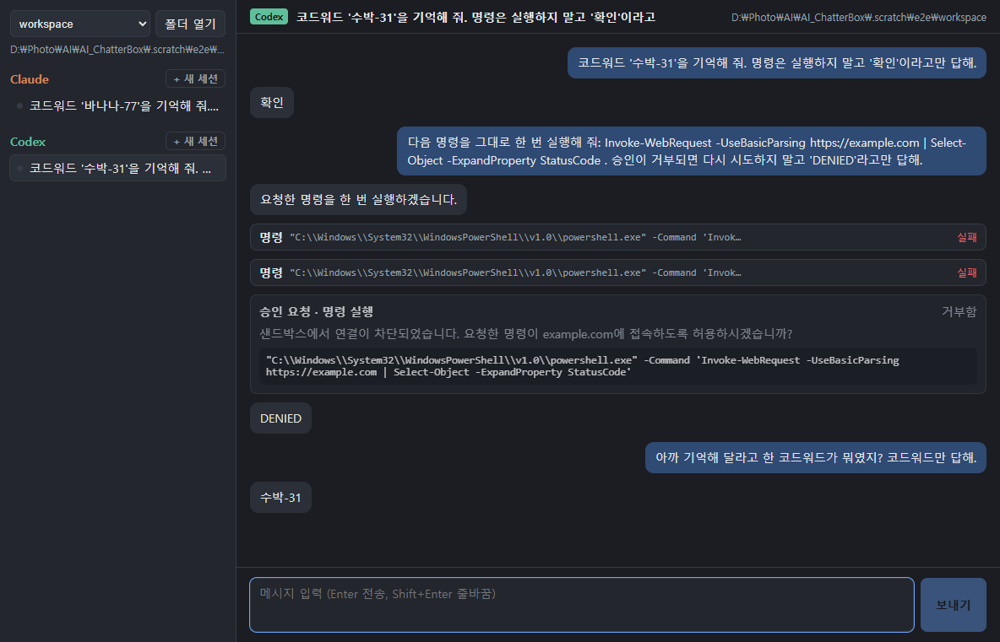

# AI_ChatterBox

Claude Code와 Codex를 한 창에서 쓰는 Windows 데스크톱 앱 (Electron + TypeScript + React).

현재 단계는 **M1 단독 채팅**이에요. Claude와 Codex 각각과 따로 대화하고, 앱을 다시 켜도 세션을 이어 갈 수 있어요.



## 필요한 것

- Windows 10/11, Node.js 22 이상 (개발 시 24 사용)
- **Claude Code 독립 설치본**, 로그인까지 된 상태
  - 설치: PowerShell에서 `irm https://claude.ai/install.ps1 | iex` → `%USERPROFILE%\.local\bin\claude.exe`
  - 로그인: `& "$env:USERPROFILE\.local\bin\claude.exe"` 실행 후 `/login`
  - Claude 데스크톱 앱에 포함된 사본(`%APPDATA%\Claude\claude-code\…`)은 쓰지 않아요. 앱이 업데이트될 때 경로가 바뀌고, 데스크톱 앱 밖에서는 로그인이 안 돼 있어요.
- **Codex**: Codex 앱(Store)이나 Codex CLI. 앱이 `%LOCALAPPDATA%\OpenAI\Codex\bin\<ver>\codex.exe`, PATH, `~\.codex\packages\standalone\releases` 순서로 찾아요.

## 실행

```powershell
npm install
npm run dev
```

- `npm run dev`: 개발 모드 (렌더러 핫 리로드)
- `npm run build` 다음 `npm start`: 빌드한 결과로 실행
- `npm run typecheck`: 타입 검사
- `npm run e2e`: 실제 CLI로 끝까지 검사 (Claude·Codex 각 2턴, 승인 거부, 종료 후 재실행해서 이어 가기). 데이터는 `.scratch/e2e`에 따로 저장해요. 실제 API를 호출하니 사용량이 조금 들어요.
- `npm run codex:schema`: 설치된 codex 버전으로 `src/main/codex-schema`를 다시 만들어요 (`codex app-server generate-ts`).

설치 파일(electron-builder) 패키징은 아직 설정하지 않았어요.

## 사용법

1. 왼쪽 위 **폴더 열기**로 작업 폴더를 워크스페이스로 추가해요.
2. Claude나 Codex 그룹의 **+ 새 세션**을 누르고 메시지를 보내요 (Enter 전송, Shift+Enter 줄바꿈).
3. 에이전트가 파일 쓰기나 명령 실행처럼 승인이 필요한 일을 하려고 하면 대화 안에 **승인 요청** 카드가 떠요. **허용** 또는 **거부**를 누르면 돼요.
4. **중지** 버튼은 진행 중인 응답을 멈춰요.
5. 앱을 닫았다가 다시 열고 세션을 고르면 이전 대화가 보이고, 이어서 말하면 같은 CLI 세션을 다시 이어 가요.

## 구조

```
src/main/            Electron main
  index.ts           창, IPC, 종료 시 CLI 정리
  sessions.ts        세션 ↔ 드라이버 연결, 이벤트 저장·전달
  db.ts              SQLite (Electron 내장 node:sqlite, 네이티브 빌드 없음)
  locate.ts          claude.exe / codex.exe 찾기
  approval-broker.ts Claude 승인 요청을 받는 로컬 HTTP (127.0.0.1, 토큰)
  approver-mcp.ts    claude의 --permission-prompt-tool로 쓰는 stdio MCP 서버 (별도 번들)
  drivers/claude.ts  claude -p stream-json 장기 실행 프로세스 (세션당 1개, --resume)
  drivers/codex.ts   codex app-server (프로세스 1개, thread/start·thread/resume·turn/start)
  codex-schema/      codex app-server generate-ts 결과 (타입만)
src/preload/         contextBridge API (window.chatterbox)
src/renderer/        React UI
spike/               M0 기술 검증 스크립트와 결과 (spike/M0-RESULTS.md)
```

- 데이터: `%APPDATA%\AI_ChatterBox\chatterbox.db`에 워크스페이스, 세션(agent, native_id, title, cwd, status), 정규화한 이벤트를 저장해요. 원본 대화 기록은 각 CLI가 원래 두는 곳(`~\.claude`, `~\.codex`)에 그대로 있고, 이어 가기는 `native_id`(Claude session_id / Codex thread id)로 해요. `AI_CHATTERBOX_DATA` 환경 변수로 저장 위치를 바꿀 수 있어요.
- 권한: `--dangerously-skip-permissions`나 Codex yolo 모드는 쓰지 않아요. Claude는 기본 권한 모드로 돌고, 승인 요청은 MCP 승인 도구 → 로컬 HTTP → 앱 UI 순서로 와요. Codex는 `approvalPolicy: on-request`, `sandbox: workspace-write`로 돌고, `item/commandExecution/requestApproval`와 `item/fileChange/requestApproval`에 답해요. 앱이 처리하지 않는 서버 요청에는 오류로 답해서 턴이 멈추지 않게 해요.
- 앱을 끌 때 각 CLI에 stdin EOF를 보내고, 3초 안에 끝나지 않으면 `taskkill /T /F`로 프로세스 트리를 정리해요.
