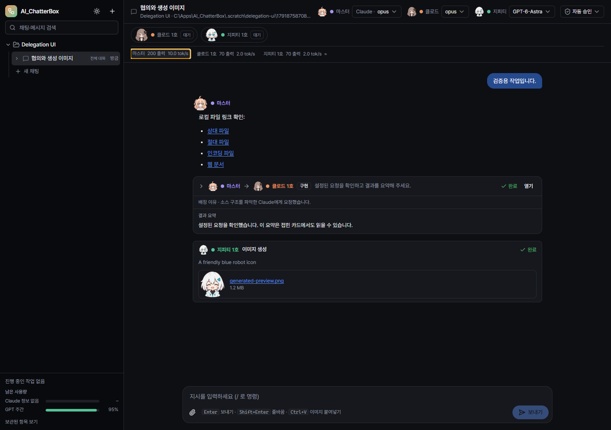
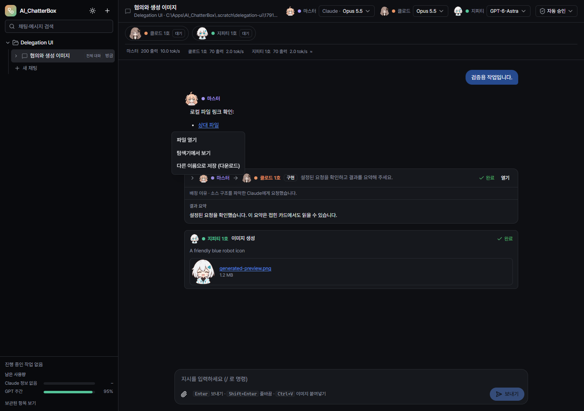
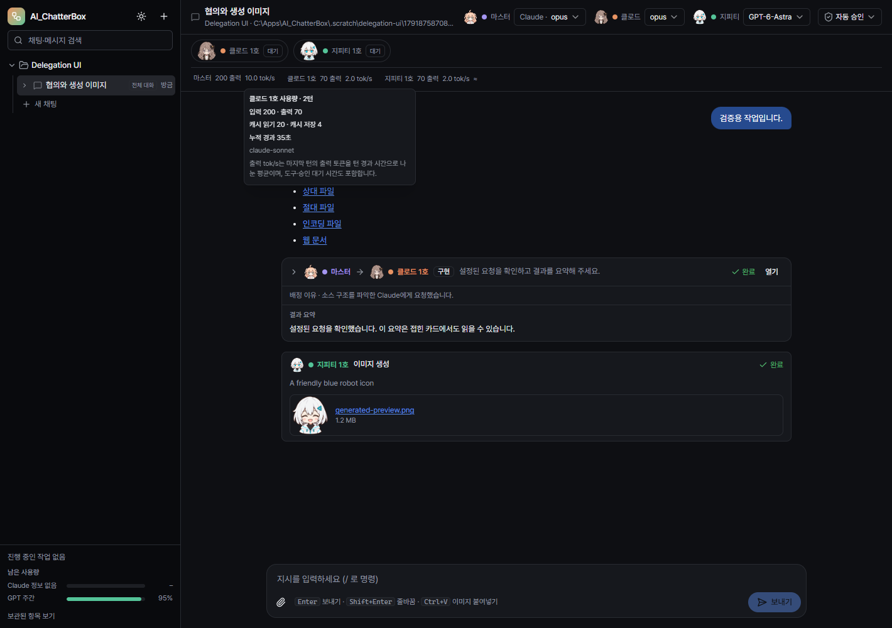

# AI_ChatterBox 0.3.2 검증 기록

검증일: 2026-10-13. 실행 중인 기존 앱과 사용자 데이터는 변경하지 않았으며, 새 실행 파일 적용은 기존 작업 종료 후 진행한다.

## 자동 검사와 격리 UI

| 검사 | 결과 | 확인 범위 |
|---|---|---|
| Node/renderer TypeScript | 통과 | 두 tsconfig의 noEmit 검사 |
| 단위 검사 | 74/74 통과 | 승인·범위·계획/리뷰 제한, 지시별 완료 확인·1회 보완·중지, 실패 협의 재배정, 빈 결과 거부, 이미지 보관·실패, 토큰 중복 집계 방지, 이벤트 재생, 파일 경로 검증 |
| 기존 설정·작업자 UI | 19/19 통과 | 두 스위치, 저장·취소·실패·재실행, 활성/해제 작업자 순서·회색·기록·가로 스크롤, 다크/라이트 |
| 배정·이미지·사용량·링크 UI | 22/22 통과 | 기본 선호·편집·취소·저장·재실행, 접힌 협의의 이유·요약, 이미지 표시, 역할별 사용량, 파일 링크 메뉴와 오류 |
| 프로덕션 빌드·포터블 | 통과 | Electron/Vite 빌드와 Windows x64 portable 생성 |

UI 검사는 실제 Electron 렌더러와 격리 SQLite 데이터를 사용했다. 파일 열기·탐색기·저장 대화상자는 테스트 프로세스 안에서 대체했고, 저장 결과 파일의 내용은 원본과 바이트 단위로 비교했다. 실제 Windows 탐색기 실행, 기본 연결 프로그램, 사용자가 조작하는 저장 대화상자는 이번 검사에 포함하지 않았다.

실행 명령:

```powershell
node node_modules/typescript/bin/tsc --noEmit -p tsconfig.node.json
node node_modules/typescript/bin/tsc --noEmit -p tsconfig.web.json
node scripts/test-unit.mjs
node node_modules/electron-vite/bin/electron-vite.js build
node scripts/e2e-settings-workers.mjs
node scripts/e2e-delegation-ui.mjs
```





위 화면은 UI 검사용 고정 데이터이며, 실제 모델 성능 측정값이나 실제 이미지 생성 프롬프트 결과를 나타내지 않는다.

## 실제 마스터와 CLI 통합 검사

`scripts/smoke-master-routing.mjs`는 사용자 요청만 마스터에게 보내고, 앱의 배정 도구를 테스트 코드가 직접 호출하지 않는다. 기존 로그인으로 격리 작업 폴더에서 실행했다.

| 마스터 | 소스 분석 | 이미지 생성 | 분석+이미지 혼합 |
|---|---|---|---|
| Claude Sonnet | 7/7 통과 | 7/7 통과 | 8/8 통과 |
| Codex gpt-6-sol | 7/7 통과 | 7/7 통과 | 8/8 통과 |

총 44개 확인을 통과했다. 소스 분석은 Claude 작업자, 실제 이미지 생성은 Codex 작업자를 통해 수행했다. 배정 이유·지시 id·작업자 응답·최종 마스터 취합·토큰 수치·저장된 PNG를 확인했다. 혼합 요청에는 별도 Claude/GPT 작업자를 사용했다. 작업자 모델은 테스트 프로젝트에서 명시적으로 Sonnet/gpt-6-sol로 선택했다.

최초 gpt-6.1-sol 마스터 분석 실행은 공급자의 `Selected model is at capacity` 오류로 완료하지 못했다. 실패 증거를 보존하고, 별도 테스트 프로젝트의 모델을 gpt-6-sol로 선택해 검사를 마쳤다. 앱이 사용자 프로젝트의 모델을 자동으로 바꾸는 동작은 추가하지 않았다.

실제 CLI 실행은 정상 배정·분석·이미지·혼합 흐름을 확인한다. 모든 모델·요금제·한도·네트워크 실패 조합을 검증한 것은 아니다. 실패 재배정, 누락 결과 보완, 이미지 오류, 중지·재시작 제한은 자동 검사로 구분해 확인했다. 0.3.1에서 수행한 관리자 자식 프로세스 실측은 이번 버전에서 반복하지 않았다.

## 표시 수치의 의미

- 입력·출력·캐시 토큰은 CLI가 보고한 값이다. 입력에는 캐시 입력도 포함하고, 캐시 읽기/저장은 별도로 보여준다.
- `tok/s`는 마지막 턴의 출력 토큰을 전체 턴 시간으로 나눈 평균이다. 도구 실행·승인·위임 대기를 포함하므로 순수 모델 디코딩 속도로 비교하지 않는다.
- Codex는 사용량 이벤트마다, Claude는 턴 종료 시 갱신한다. 같은 턴의 스냅샷은 교체하며 누적 합에 중복 추가하지 않는다.
- 복원 기준이 없거나 카운터가 초기화된 구간은 근사치로 표시한다. 과거 대화에 사용량 이벤트가 없으면 추정값을 만들어 넣지 않는다.
- 계정 전체의 남은 5시간·주간 한도와 역할별 토큰은 별도 정보다.

## 배포 파일

- 파일: `dist/AI_ChatterBox-0.3.2-portable.exe`
- 크기: 150,336,987 bytes
- SHA256: `F839903EF504976D299B5CB5B2F12B119F5EE668825179E5750E97E788F87E50`
- 포터블 실행기와 내부 `AI_ChatterBox.exe` 모두 PE 매니페스트의 `requireAdministrator` 확인.
- 패키지 버전 0.3.2, ASAR의 빌드 파일과 현재 `out`의 일치, 치비 PNG 36개 포함 확인.
- UAC 승인/취소를 포함한 새 포터블의 실제 실행은 이번 배포 검사에서 수행하지 않았다.

## 로컬 증거 위치

검사 원본은 개인정보·세션 기록과 함께 커밋하지 않고 `.scratch` 아래에 남겼다.

- Codex 전체: `.scratch/master-routing-1791874491075`
- Claude 이미지·혼합: `.scratch/master-routing-1791874491112`
- Claude 분석 및 최초 Codex 용량 오류: `.scratch/master-routing-1791874304409`
- 설정·작업자 UI: `.scratch/ui-verification/1791875827952`
- 신규 UI: `.scratch/delegation-ui/1791875870808`
