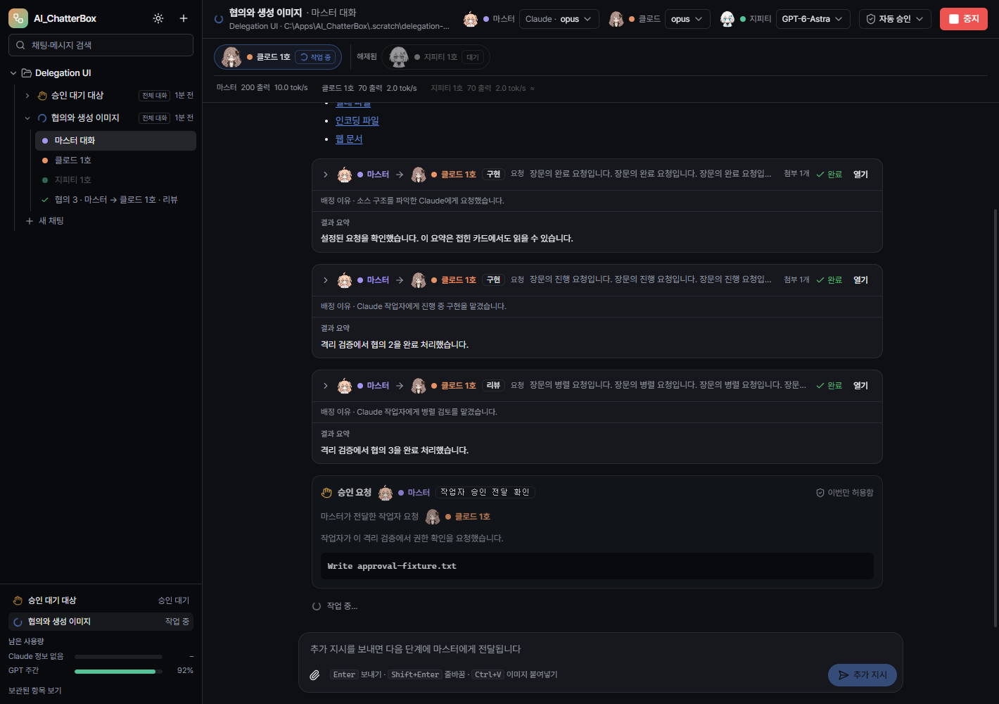

# AI_ChatterBox 0.3.3 검증 기록

검증일: 2026-10-13. 기존 ChatterBox 앱과 실행 중인 사용자 작업은 중단하지 않았다. 새 포터블 적용은 작업 종료 후 진행한다.

## 자동 검사와 화면

| 검사 | 결과 | 범위 |
|---|---|---|
| Node/renderer TypeScript | 통과 | 두 tsconfig noEmit |
| 단위 검사 | 87/87 | 기존 승인·계획·범위 제한, 중요 오류 양쪽 조사, 번호·대화 재사용, 알림 타이머, Claude 보관·충돌 방지·복원, 보관 중 다음 작업 직렬화 |
| 설정·작업자 UI | 19/19 | 설정 저장·취소·실패·재실행, 가로줄·해제 상태·테마 |
| 배정·승인 UI | 50/50 | 접힌 요청, 동시 협의와 최종 한 건, 해제 접미사 제거, 하단 채팅 이동, 작업자 승인의 마스터 표시·원래 승인 ID 전달, 기존 파일 링크·이미지·사용량 |
| 프로덕션 빌드 | 통과 | Electron/Vite |

UI 검사는 격리 SQLite와 실제 Electron 렌더러에서 실행했다. 외부 파일 열기·탐색기·저장 대화상자는 테스트 어댑터로 대체했다. 알림 검사는 제어된 타이머와 Electron Notification 어댑터에서 즉시 알림, 60초 후 한 번 재알림, 해결·중지·오류·종료 시 취소, 최종 완료 한 번, 알림 클릭의 채팅 이동을 확인했다. 실제 Windows 토스트 화면과 집중 지원 설정은 이번 자동 검사의 대상이 아니다.



위 화면은 고정된 UI 검증 데이터다. 승인 카드의 마스터 표시와 별도 요청 작업자 표시를 확인하며, 실제 모델 측정값은 아니다.

## 실제 CLI 검사

`scripts/smoke-master-routing.mjs`는 테스트 코드에서 배정 도구를 직접 호출하지 않고 실제 마스터에게 사용자 요청을 보낸다. Sonnet과 gpt-6-sol을 테스트 프로젝트에 명시적으로 선택했다.

| 실제 실행 | 결과 |
|---|---|
| Codex 마스터: 일반 분석 | 8개 통과, Claude 작업자만 사용 |
| Claude·Codex 마스터: 중요 오류 | 각각 12개 통과, 두 계열 독립 병렬 조사와 최종 취합 |
| Claude·Codex 마스터: 간단한 산술 답변 | 각각 4개 통과, 작업자 생성·호출 없음 |
| Codex 마스터: 작업자 해제 후 재호출 | 9개 통과, 기존 작업자 ID·번호 재사용 |
| Codex 마스터: 모션그래픽 | 9개 통과, Claude가 실제 CSS 애니메이션 HTML 작성 |
| 보관 연결 후 재실행: 재사용 + 중요 오류 | 21개 통과, 전체 배정·결과·취합 재확인 |
| `scripts/smoke-native-sessions.mjs` | 11개 통과, 실제 네이티브 프로젝트·보관·복원·기억 유지 |

초기 시나리오 58개 확인과 보관 연결 후 반복 21개 확인은 구분한다. 네이티브 검사에서는 각 CLI에 식별 문자열을 기억하게 한 뒤 보관하고 새 드라이버로 재연결했다. 두 계열 모두 같은 native ID에서 해당 문자열을 답했다. Codex는 `AI AGENT` projectId와 실제 작업 cwd 유지, 활성 목록 제외·보관 목록 포함을 확인했다. Claude는 활성 transcript 경로에서 제외하고 보관 경로로 이동한 뒤 원래 위치로 복원해 `--resume`했다.

실제 실행 증거는 로컬 `.scratch/master-routing-1791877948508`, `1791877948477`, `1791878435795`, `1791880095314`, `1791881669025` 및 `.scratch/native-sessions-1791881549015`에 보관했다. 화면 증거는 `.scratch/delegation-ui/1791880607654`와 `.scratch/ui-verification/1791878712710`이다. 대화 원문·로그인 정보·개인 설정은 Git에 포함하지 않는다.

0.3.2에서 확인한 실제 이미지 생성·혼합 요청은 이번 버전에서 반복하지 않았다. 모든 모델·사용 한도·네트워크 장애 조합을 실제 호출한 것은 아니다. 실패·중지·재실행·누락 결과 제한은 자동 검사 범위와 구분한다. 설비와 연결하지 않은 예제 코드만 사용했다.

## 네이티브 프로젝트·보관의 적용 범위

- Codex는 설치된 CLI가 생성한 실험적 스키마의 `project/list`, `project/create`, `thread/start.projectId`, `thread/metadata/update.projectId`를 사용한다. 생성 직후 비어 있는 로그에 이름을 저장하지 않고 첫 작업 종료 후 저장한다. 보관 전에 구독을 해제해 writer를 닫고, 다음 호출 전에 `thread/unarchive`한다. 지원하지 않는 CLI에서는 분류 실패를 알리고 작업을 계속한다. [App Server 문서](https://learn.chatgpt.com/docs/app-server)
- 실행 중인 Codex 데스크톱의 프로젝트 캐시는 별개다. 설치된 26.1007.2314.0 소스에서 연결 초기화 때 프로젝트 목록을 읽는 경로를 확인했다. 현재 앱의 `list_projects`는 기존 LOCAL 목록을 반환했고, 재시작 후 사이드바 표시까지는 확인하지 않았다. 진행 중인 사용자 앱을 재시작하거나 전역 설정 JSON을 강제로 수정하지 않았다. 작업 종료 후 Codex 재실행으로 목록을 갱신해야 할 수 있다.
- Claude CLI는 Desktop 프로젝트 지정·보관 API를 제공하지 않는다. `[AI AGENT]` 대화 이름을 사용하고, ChatterBox가 만든 작업자의 프로세스가 종료된 후 UUID transcript와 동반 폴더만 `CLAUDE_CONFIG_DIR/chatterbox-archived-sessions`에 보관한다. 경로 충돌이나 알려지지 않은 `sessions-index.json`이 있으면 원본을 유지하고 안내한다. 다음 호출 전에 복원한다. Claude Desktop의 프로젝트 생성·목록 표시와 같다고 주장하지 않는다. [Claude CLI](https://code.claude.com/docs/en/cli-reference), [Desktop 세션 범위](https://code.claude.com/docs/en/desktop)
- 이 처리는 새로 실행한 ChatterBox 작업자에 적용한다. 이미 실행 중인 이전 버전의 세션이나 다른 프로그램의 대화를 일괄 정리하지 않는다. ChatterBox 안의 협의·작업자 기록과 마스터 원본 대화는 자동 삭제하지 않는다.

## 배포 검증

포터블: `dist/AI_ChatterBox-0.3.3-portable.exe`.

- 크기: 150,341,678 bytes
- SHA-256: `DCDBC60F411393AE2EFD0431B875F08CC475FDA65CD8FBBE8F0014329537FB54`
- 패키지의 버전 0.3.3, 빌드 파일 134개의 바이트 일치, 캐릭터 PNG 36개 포함을 확인했다.
- 포터블 실행기와 내부 실행 파일 모두 `requireAdministrator` 매니페스트 검사를 통과했다.

UAC 창 취소·승인과 관리자 자식 프로세스 실측은 0.3.1의 결과이며 이번 버전에서 반복하지 않았다. 위 자동 검사와 실제 Windows 사용자 확인 범위는 구분한다.

## 재현 명령

```powershell
node node_modules/typescript/bin/tsc --noEmit -p tsconfig.node.json
node node_modules/typescript/bin/tsc --noEmit -p tsconfig.web.json
node scripts/test-unit.mjs
node node_modules/electron-vite/bin/electron-vite.js build
node scripts/e2e-settings-workers.mjs
node scripts/e2e-delegation-ui.mjs
node scripts/smoke-native-sessions.mjs
$env:CBX_PROVIDERS='codex'
$env:CBX_SCENARIOS='reuse,critical'
$env:CBX_GPT_MODEL='gpt-6-sol'
node scripts/smoke-master-routing.mjs
```
