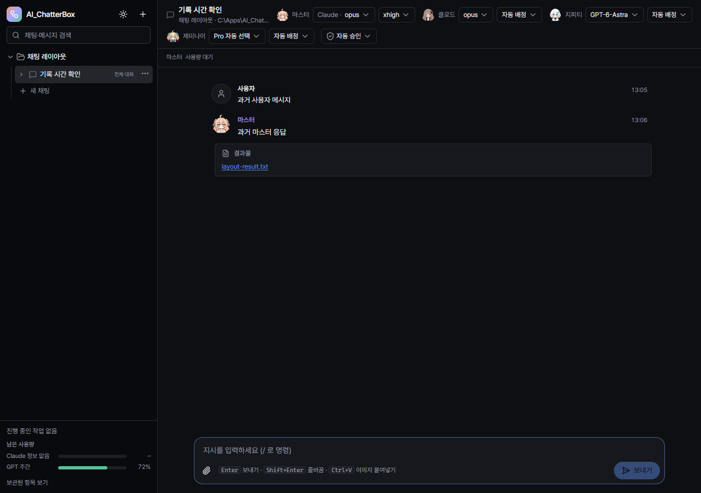
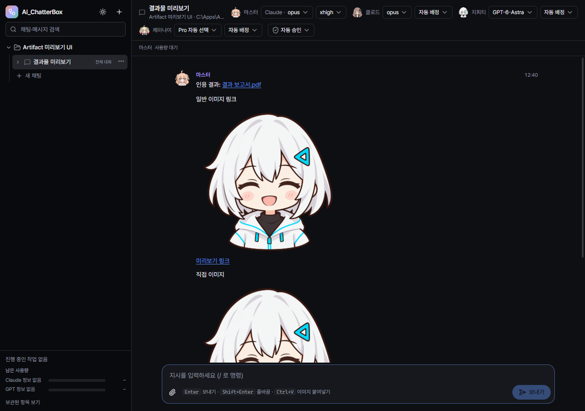

# AI_ChatterBox 0.3.5 검증 기록

검증일: 2026-10-14. 테스트는 별도 SQLite·첨부 폴더와 임시 작업 폴더를 사용했습니다. 실행 중인 사용자 작업은 중단하지 않았습니다.

## 확인된 범위

| 구분 | 결과 | 증거 경로 |
|---|---:|---|
| 실제 effort smoke | **26/26** | `%TEMP%\chatterbox-effort-smoke-1791946223247` |
| effort UI | **23/23** | `.scratch\effort-ui\1791945687221` |
| settings UI | **22/22** | `.scratch\ui-verification\1791946274107` |
| Node/Web 타입 검사 | 통과 | `tsc --noEmit -p tsconfig.node.json`, `tsconfig.web.json` |
| 단위 검사 | **134/134** | `.scratch\unit-0.3.5.log` |
| 실제 Codex 즉시 전달 | **6/6** | `%TEMP%\chatterbox-steering-1791947665282\results.json`의 Codex 검사 |
| 실제 Claude 즉시 전달 | **6/6** | `%TEMP%\chatterbox-steering-1791948333068\results.json` |
| Discord 대화·전달 버튼·재실행 UI | **13/13** | `.scratch\e2e-chat-layout` |
| 파일 링크·이미지 미리보기 UI | **8/8** | `.scratch\artifact-preview-ui\1791949235685` |
| 캐릭터 자산 | **48/48** | `verify-character-assets.mjs`: 1254×1254, 투명/불투명 픽셀, 갤러리 검사 |
| 프로덕션 빌드·포터블 패키징 | 통과 | `.scratch\build-0.3.5.log`, `.scratch\package-0.3.5-final.log` |
| 배포 무결성·실행 권한 설정 | 통과 | ASAR의 147개 파일이 최종 `out`과 동일, 포터블·내부 실행 파일 모두 `requireAdministrator` |

추론 smoke는 실제 Claude·Codex 마스터에서 xhigh를 전달하고 Claude·Codex·Gemini 작업자에 medium을 배정해 파일 읽기·응답·최종 취합을 확인했습니다. 기록한 추론 수준은 CLI에 전달한 옵션입니다. 서비스의 내부 추론량이나 Claude 조직 정책으로 제한된 최종 수준을 측정한 것은 아닙니다.

즉시 전달은 실제 협의 실행 중 추가 메시지를 보내 기존 작업자가 완료되고 마스터가 추가 요구를 최종 답변에 반영하는지 확인했습니다. 첫 Claude 검사에서는 작업자가 계속 실행됐지만 native ask 응답이 끊겨 같은 결과를 재요청했습니다. `agents`에서 저장된 결과를 복구하고, 마스터가 먼저 끝나도 진행 중 작업자를 기다려 취합하도록 보완한 후 재검사를 통과했습니다. 중지 뒤 steer 거부, 복수 메시지 UUID 처리, 결과 대기 중 수동 중지는 단위 검사에 포함합니다.

미리보기 UI는 첫 실행에서 IPC 입력을 검증하고 재실행에서는 실제 preview IPC와 파일 복사를 사용했습니다. 원격 이미지는 자동 다운로드하지 않고 링크로 남깁니다. 과거 인용 표기는 코드 블록을 보존하면서 파일 링크로 바뀝니다.

## 배포 파일

- 파일: `dist/AI_ChatterBox-0.3.5-portable.exe`
- 크기: 163,720,556 bytes
- SHA-256: `5C6EE65BD76FD2564DF27DC0941D183B7A10A6F67850B6BB826F01CC2C76EE27`
- 기존 작업이 끝난 뒤 현재 앱을 종료하고 새 실행 파일을 사용합니다. 데이터 위치는 그대로 유지합니다.

## 이번 실행에서 확인하지 않은 항목

- 이번 실행에서는 UAC 승인·취소와 관리자 자식 프로세스를 다시 실측하지 않았습니다. 매니페스트 검사는 실제 UAC 검사를 대신하지 않습니다.
- Gemini CLI 1.3.4의 지원되는 원본 대화 archive/restore 경로를 확인하지 못해 원본 목록 자동 보관은 구현하지 않았습니다. ChatterBox 기록 저장·해제·재호출은 유지하며 내부 데이터베이스를 임의로 변경하지 않습니다.
- 앱의 지시·협의 시간 제한을 제거했습니다. 공급자 자체 도구·네트워크 제한과 사용량 한도까지 무제한이라는 뜻은 아닙니다. 승인 판단의 사용자 복귀 시간과 배정·리뷰 횟수 제한도 유지합니다.
- 이미지 미리보기는 원본을 처음 표시할 때 보관합니다. 같은 경로가 나중에 변경되면 갱신된 미리보기를 사용하며 파일의 모든 과거 버전을 재현하지는 않습니다.

참고: [Codex App Server](https://learn.chatgpt.com/docs/app-server), [Claude SDK 메시지·priority](https://code.claude.com/docs/en/agent-sdk/typescript), [Claude 모델 정책](https://code.claude.com/docs/en/model-config), [Antigravity 대화 관리](https://antigravity.google/docs/cli/conversations/).
