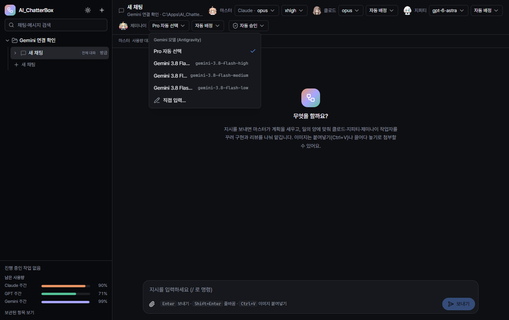

# AI_ChatterBox 0.3.6 검증 기록

검증일: 2026-10-14. 실행 중인 사용자 앱·작업은 유지하고 별도 데이터 폴더에서 검사했습니다.

## 변경과 원인 확인

- 신고 화면의 설치 안내는 CLI 파일 탐색이 실패했을 때 나오는 문구였습니다. 현재 사용자 계정에서는 설치 파일과 로그인 모두 정상이며 Gemini 3.8 Flash High·Medium·Low를 조회했습니다. 최초 탐색 실패 자체는 재현하지 못했습니다.
- 기존 모델 메뉴는 초기 실패 후 다시 열어도 조회하지 않아 오류가 남았습니다. 재열기 자동 재시도와 **목록 다시 확인**을 추가하고, Windows LOCALAPPDATA가 잘못되거나 비어 있어도 사용자 프로필의 설치 폴더를 확인합니다. 설치 누락과 인증·네트워크 오류 문구를 구분합니다.
- 왼쪽 아래에 Gemini의 주간·5시간 잔여 한도를 연결했습니다. 5시간 잔여량이 10% 이하이면 그 한도를 우선 표시합니다. 초기화 시간·조회 시각 툴팁, 시작 시·5분 주기 갱신, 저장·재실행 복원, 조회 실패 표시를 포함합니다.
- Gemini Models 그룹만 사용합니다. Antigravity의 Claude/GPT 한도를 별도 Claude Code·Codex 계정 한도로 합치지 않습니다.

## 검증

| 구분 | 결과 | 증거 |
|---|---|---|
| Node/Web 타입 검사 | 통과 | 두 tsconfig의 tsc --noEmit |
| 단위 검사 | 142/142 | 전체 test-unit.mjs, 신규 파서 6건·탐색 2건 포함 |
| 실제 CLI 조회 + 격리 UI | 11/11 | `.scratch/gemini-usage-ui-0.3.6.log`, `.scratch/gemini-usage-ui/1791950890162` |
| 프로덕션 빌드 | 통과 | `.scratch/build-0.3.6.log` |
| 포터블 패키징 | 통과 | `.scratch/package-0.3.6.log` |
| 관리자 실행 manifest·배포 무결성 | 통과 | 포터블·내부 EXE 모두 requireAdministrator, ASAR의 147개 파일이 최종 out과 일치 |

실제 Antigravity CLI 1.3.5의 `-p /usage --output-format json` 응답에서 `command.name=usage`, `num_turns=0`, 입출력·생각 토큰 0과 두 한도·초기화 시각을 확인했습니다. CLI 조회에는 모델 턴이 필요하지 않습니다. 초기 탐색 오류·한도 5%·조회 실패는 UI 테스트에서 주입한 상황이며 실제 계정 장애가 아닙니다. 처음 UI 검사에서 줄바꿈 정규식과 메뉴 role 선택자가 잘못되어 실패했고 테스트를 수정한 뒤 11건 모두 통과했습니다.

다크·라이트 화면과 모델 메뉴를 직접 확인했습니다. 배포 앱의 UAC 및 실행 중 사용자 앱의 환경은 이번 검사에서 다시 조작하지 않았습니다. 새 실행 파일 적용 후 사용자 환경에서 재확인이 필요합니다.

공식 근거: [CLI headless 읽기 전용 명령](https://antigravity.google/docs/cli/headless/), [사용 한도](https://antigravity.google/docs/cli/commands/usage/).

산출물: `dist/AI_ChatterBox-0.3.6-portable.exe` (163,721,597 bytes). SHA256: `04AE86032F66C1B957F22C2536676226405D027F9E24C3A0C8B09350167F2A90`.

