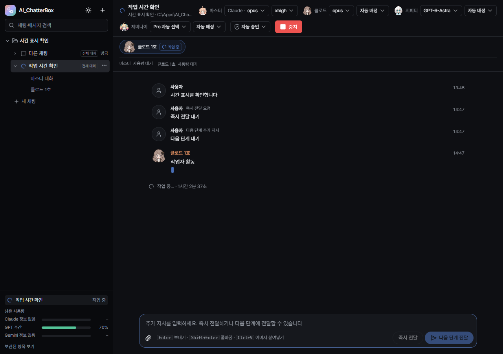

# AI_ChatterBox 0.3.7 검증 기록

검증일: 2026-10-14. 실행 중인 사용자 앱과 작업은 유지했습니다.

## 변경과 원인

- 실제 저장 기록을 읽기 전용으로 조사했습니다. 14:13의 추가 질문은 마스터에게 전달됐지만, 마스터의 `route_request(mode=direct)`가 기존 위임 작업을 직접 처리로 바꾸려는 요청으로 판정되어 거부됐습니다. 이후 체크리스트와 작업 배정만 이어지고 질문에 대한 대사는 없었습니다.
- 즉시 추가 질문의 직접 답변은 기존 지시의 위임·독립 조사·교차 리뷰 요건을 바꾸지 않습니다. 답변 전 팀 관리 도구로 넘어가면 먼저 사용자에게 답하도록 안내합니다.
- 마스터가 앱 협의 결과를 기다릴 때는 그 대기만 풀어 추가 요청을 처리합니다. 작업자의 실행·범위 잠금·결과 저장은 유지하며, 작업자 완료 후 같은 마스터가 결과를 취합합니다. 중지 요청 뒤에는 재개하지 않습니다.
- 하단 `작업 중…`에 현재 지시 시작부터의 경과 시간을 1초마다 표시합니다. 승인 대기를 포함한 벽시계 시간입니다. 작업 중 받은 추가 메시지는 시간을 초기화하지 않으며, 전체·마스터·작업자 화면을 오가도 같은 시작 시각을 사용합니다. 이전 기록에 시작 지시가 없으면 채팅 생성 시각을 사용합니다.
- 대화 활동이 최근 활동 시각에 반영되지 않던 경로를 수정했습니다. 완성 메시지·작업 이벤트·추가 사용자 메시지에서 갱신하고, 스트리밍 조각은 15초 간격으로 제한합니다. 사용량·표정 갱신은 대화 활동으로 취급하지 않습니다. 왼쪽 상대 시간은 새 메시지가 없어도 30초마다 다시 계산합니다.

## 검증

| 구분 | 결과 | 범위 |
|---|---|---|
| Node/Web 타입 검사 | 통과 | 두 tsconfig의 tsc --noEmit |
| 자동 회귀 검사 | 150/150 | 직접 추가 질문·기존 독립 조사 유지·협의 대기 해제·중지 경쟁·활동 시각·시간 계산 포함 |
| 격리 UI | 14/14 | 1시간 이상 경과 표시, 초 증가, 추가 메시지/작업자 이벤트 무시, 화면 전환, idle 숨김, 30초 상대 시간 갱신, 최근 활동 푸시 |
| 실제 마스터 CLI + 제어된 작업자 | 14/14 | Claude Sonnet 및 Codex GPT-6.1-Sol 각각 질문 선응답, 기존 배정 유지, 수정된 제목 반영, 단일 작업자 결과 취합 |
| 프로덕션 빌드 | 통과 | electron-vite build |
| 포터블 패키징 | 통과 | `.scratch/package-0.3.7.log` |
| 실행 권한·배포 무결성 | 통과 | 포터블·내부 EXE 모두 requireAdministrator, 배포 ASAR의 147개 파일이 최종 out과 일치 |

UI는 격리 데이터베이스와 Playwright의 가상 시계로 검사했습니다. 증거: `.scratch/chat-time-ui/1791956829407`.

CLI 검사는 실제 마스터 세션과 앱 MCP 브리지를 사용했습니다. 작업자 자체는 테스트 더블이며 마스터의 답변까지 완료를 보류했습니다. 마스터가 기존 작업자가 실행 중인 상태에서 답하고, 작업자 결과를 제공한 후 합계 42를 취합했으며 작업자/협의를 중복 생성하지 않았습니다. 이 실행의 질문 응답은 Claude 약 39초, Codex 약 16초였습니다. 이는 모델 응답 지연을 포함한 한 번의 관측값으로 응답 시간 보장은 아닙니다. 작업자 자체의 실제 CLI 실행은 이 검사 대상이 아닙니다. 증거: `%TEMP%/chatterbox-immediate-1791956796042/results.json`.

재현 명령: `node scripts/test-unit.mjs`, `node scripts/e2e-chat-time.mjs`, `node scripts/smoke-immediate-reply.mjs`.

배포 앱의 UAC 및 현재 실행 중인 사용자 앱은 다시 조작하지 않았습니다. 새 포터블은 진행 중인 작업이 끝난 뒤 적용합니다.

산출물: `dist/AI_ChatterBox-0.3.7-portable.exe` (163,722,258 bytes).
SHA256: `FE83C4C6C4436256A9398724A6A34D56E19279DD29CE23AB0944615141FE5ECB`.

